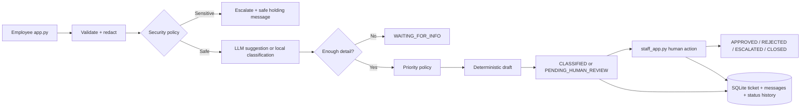

# PROJECT_PLAN - IT Support System

## اسم المشروع والمشكلة

**IT Support System** يساعد مكتب الدعم الفني الداخلي على تحويل رسائل الموظفين غير المنظمة إلى تذاكر قابلة للتتبع، مع تصنيف وأولوية ومسودة رد آمنة ومراجعة بشرية عند الحاجة.

الهدف ليس بناء chatbot مستقل، بل بناء **AI-assisted workflow** محدود وقابل للتفسير.

## المستخدمون

- الموظف يرسل المشكلة ويتابع التذكرة.
- موظف الدعم يدخل إلى `staff_app.py` ويراجع التذاكر ويتخذ القرار.
- `app.py` و`staff_app.py` تطبيقان منفصلان لكنهما يستخدمان نفس قاعدة SQLite.

## ما يفعله النظام

- يتحقق من الحقول والحدود.
- ينظف المسافات ويزيل أنماطًا معروفة من الأسرار.
- يصنف المشكلة إلى Software أو Hardware أو Network أو Authentication أو General أو Other.
- يحدد الأولوية من policy مكتوبة في الكود.
- يصعّد طلبات credentials والحوادث الأمنية ومخاطر السلامة.
- يطلب معلومة ناقصة عندما تكون الرسالة غامضة.
- يبني مسودة من قوالب deterministic.
- يخزن التذكرة والمحادثة وسجل الحالات في SQLite.
- يسمح لموظف الدعم بالاعتماد أو الرفض أو التصعيد أو الإغلاق.

## ما لا يفعله النظام

- لا يطلب أو يعرض كلمات مرور أو رموزًا أو مفاتيح.
- لا يغير كلمات المرور أو الصلاحيات.
- لا يشغل كودًا كتبه LLM.
- لا يرسل troubleshooting مولدًا من LLM بشكل تلقائي.
- لا يعتبر `approved_response` موجودًا إلا بعد قرار APPROVE.
- لا يخلط بين `reviewer_note` الداخلية والرد المرسل للمستخدم.
- لا يلمس أنظمة production مباشرة.

## عقد الإدخال

| الحقل | مطلوب | القاعدة |
|---|---:|---|
| `customer_id` | نعم | غير فارغ، حد أقصى 100 حرف |
| `contact_detail` | لا | بريد اختياري بصيغة صحيحة، حد أقصى 100 حرف داخل النظام الحالي |
| `department` | لا | تنظيف وحد أقصى 100 حرف |
| `device_or_system` | لا | تنظيف وحد أقصى 100 حرف |
| `message` | نعم | بعد normalization من 10 إلى 2000 حرف |

إذا تجاوزت الرسالة 2000 حرف أو فشل التحقق، لا يتم إنشاء ticket.

## دور الـLLM

عند وجود API key، يستطيع الـLLM اقتراح التصنيف أو سؤال متابعة عبر JSON محدود. يتم التحقق من `action` و`category` والحقول النصية، وأي فشل يرجع إلى القواعد المحلية.

الـLLM لا يقرر الأولوية ولا التصعيد. كما أن مسار الرد التلقائي يستخدم قوالب محلية allow-listed. المتابعة داخل التذكرة تستخدم ردًا deterministic، ولا ترسل troubleshooting حرًا من النموذج للمستخدم.

## الـworkflow

## قواعد الأولوية

- **HIGH:** حادث أمني أو credential أو خطر سلامة أو أثر واسع مثل everyone/all users/network down.
- **MEDIUM:** مشكلة اعتيادية لمستخدم واحد.
- **LOW:** سؤال عام أو طلب غير عاجل أو رسالة غير واضحة أو خارج النطاق.

الأولوية لا تأتي من الـLLM.

## انتقالات الحالات

يتم فرض transition map في `database.py`:

- `RECEIVED` و`VALIDATED` يمكن أن تنتقلا إلى مسارات المعالجة.
- `WAITING_FOR_INFO` يمكن أن تعود إلى الانتظار أو تكمل إلى التصنيف والمراجعة أو التصعيد.
- `CLASSIFIED` و`DRAFT_READY` تسمح بالمراجعة أو الاعتماد أو الرفض أو التصعيد أو الإغلاق.
- `PENDING_HUMAN_REVIEW` تسمح بـ`APPROVED`, `REJECTED`, `ESCALATED`, `CLOSED`.
- `ESCALATED`, `APPROVED`, `REJECTED` تسمح بالإغلاق.
- `CLOSED` نهائية.

أي انتقال غير موجود في الخريطة يرفضه backend حتى لو حاولت الواجهة تنفيذه.

## فصل بيانات المراجع عن رد المستخدم

- `reviewer_note`: ملاحظة داخلية للمراجع.
- `approved_response`: رد المستخدم الذي نتج عن `APPROVE` فقط.
- عند `REJECT` لا يتم تخزين الملاحظة كـapproved response ولا يتم إرسالها للمستخدم.
- عند `APPROVE` مع نص، يكون النص هو الرد المعتمد؛ وعند عدم وجود نص تعتمد المسودة المحلية.

## واجهات النظام

### `app.py`

واجهة الموظف: تفاصيل الموظف، إنشاء ticket، متابعة المحادثة، فتح ticket موجودة، عرض الحالة والقرار.

### `staff_app.py`

واجهة الدعم: تسجيل دخول تجريبي، فلاتر، تفاصيل ticket، المحادثة، المسودة، الرد المعتمد، الملاحظات الداخلية، أزرار القرار، وسجل الحالات.

تم دمج محتوى الصفحات سابقًا في `views/new_ticket.py` و`views/dashboard.py` داخل الملفين الرئيسيين، ثم حذف مجلد `views`.

## قرارات التخزين

SQLite مختارة لأنها كافية لنسخة صغيرة وداخلية ولأن التذكرة تبقى بعد إعادة التشغيل. قبل الإنتاج الحقيقي يلزم إضافة authentication أقوى، migrations، backup، indexes، monitoring، وضبط concurrency مناسب.

## اختبارات أساسية قبل العرض

- رسالة فارغة وأقل من الحد الأدنى.
- رسالة أطول من 2000 حرف.
- رسالة تحتوي secret pattern والتأكد من ظهور warning.
- `firewall` لا يطابق `fire`.
- `passwordless` لا يطابق طلب password.
- عطل عادي، عطل واسع، رسالة غامضة، credential request، وout-of-scope.
- رفض مسودة مع ملاحظة والتأكد أن الملاحظة لا تظهر كـapproved response.
- محاولة انتقال حالة غير مسموح والتأكد من رفض backend لها.
