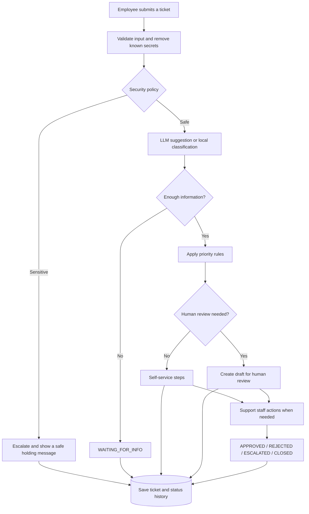

# Project Plan — TicketFlow AI (IT Support)

## 1. Project overview

TicketFlow AI helps an internal IT support team turn employee messages into trackable tickets with a category, priority, a safe draft reply, and human review when needed.

The goal is not to build a standalone chatbot. It is to build a limited and explainable **AI-assisted workflow**.

## 2. Users

- **Employee:** submits an issue and follows the ticket.
- **Support staff:** signs in through `staff_app.py`, reviews tickets, and makes decisions.
- `app.py` and `staff_app.py` can run separately while using the same SQLite database. `streamlit_app.py` provides a combined interface.

## 3. Main features

- Validate input fields and length limits.
- Normalize whitespace and remove known secret patterns.
- Classify issues as `Software`, `Hardware`, `Network`, `Authentication`, `General`, or `Other`.
- Set priority using rules in code.
- Escalate credential requests, security incidents, and safety risks.
- Ask for missing information when a message is unclear.
- Provide safe self-service troubleshooting steps for routine issues.
- Create draft replies from fixed templates for tickets that need human review.
- Store tickets, conversations, and status history in SQLite.
- Let support staff approve, reject, escalate, or close tickets.

## 4. Scope and safety limits

The system:

- Does not ask for or display passwords, tokens, or keys.
- Does not change passwords or permissions.
- Does not run code written by an LLM.
- Sends LLM-suggested troubleshooting steps to users only if they pass the safety filter. Otherwise, prepared local steps are used.
- Creates an approved reply only after an `APPROVE` decision.
- Keeps internal `reviewer_note` content separate from the reply sent to the user.
- Does not interact directly with production systems.

## 5. Input rules

| Field | Required | Rule |
|---|---|---|
| `customer_id` | Yes | Must not be empty; maximum 100 characters |
| `contact_detail` | No | Optional valid email; maximum 100 characters |
| `department` | No | Cleaned; maximum 100 characters |
| `device_or_system` | No | Cleaned; maximum 100 characters |
| `message` | Yes | 10–2000 characters after normalization |

If validation fails or the message is longer than 2000 characters, no ticket is created.

## 6. Role of the LLM

When an API key is available, the LLM may suggest a category, a follow-up question, or two to four self-service steps using a limited JSON format. The `action`, `category`, and text fields are validated. If the output fails validation or the LLM is unavailable, the system falls back to local rules.

The LLM does **not** decide priority or escalation. Suggested troubleshooting steps must pass a strict filter for length, unsafe commands, credentials, links, and forbidden phrases. If they fail, prepared local steps are used. Follow-up replies use fixed templates.

## 7. Workflow

## 8. Priority rules

- **HIGH:** security incident, credential request, safety risk, or a wide-impact issue such as a network outage affecting everyone.
- **MEDIUM:** a routine issue affecting one user.
- **LOW:** a general question, non-urgent request, unclear message, or issue outside the system's scope.

Priority is determined by code and policy rules, never by the LLM.

## 9. Ticket status rules

Status transitions are enforced in `database.py`:

- `RECEIVED` and `VALIDATED` can move into the processing workflow.
- `WAITING_FOR_INFO` can remain waiting, continue to classification and review, or be escalated.
- `CLASSIFIED` and `DRAFT_READY` can move to review, approval, rejection, escalation, or closure.
- `PENDING_HUMAN_REVIEW` can move to `APPROVED`, `REJECTED`, `ESCALATED`, or `CLOSED`.
- `ESCALATED`, `APPROVED`, and `REJECTED` can move to closing.
- `CLOSED` is final.

The backend rejects any transition that is not allowed, even if the interface attempts it.

## 10. Replies and internal notes

- `reviewer_note` is an internal note for the support reviewer.
- `approved_response` is the reply for the user and is created only after `APPROVE`.
- On `REJECT`, the note is not stored as an approved reply and is not sent to the user.
- On `APPROVE` with text, that text becomes the approved reply and appears in the chat and email. If no text is provided, the system's draft is approved.

## 11. Interfaces

### `app.py`

The employee interface for entering details, creating a ticket, following the conversation, opening an existing ticket, and checking its status and decision.

### `staff_app.py`

The support interface for login, filtering tickets, viewing ticket details and conversations, reviewing drafts and approved replies, adding internal notes, making decisions, and checking status history.

### `streamlit_app.py`

A combined entry point for the employee and support interfaces.

## 12. Storage

SQLite is used because it is suitable for a small prototype and stores tickets between local app restarts. Before real production use, the project needs stronger authentication, database migrations, backups, indexes, monitoring, and proper concurrency handling.

## 13. Basic tests

- Submit an empty message and a message below the minimum length.
- Submit a message longer than 2000 characters.
- Submit a message containing a known secret pattern and check that a warning appears.
- Check that `firewall` does not match `fire`.
- Check that `passwordless` does not match a password request.
- Test a routine issue, a wide-impact issue, a vague message, a credential request, and an out-of-scope message.
- Reject a ticket with a note and check that the note is not shown as an approved reply.
- Approve a ticket with text and check that the same text appears in the chat and email.
- Attempt an invalid status transition and check that the backend rejects it.
