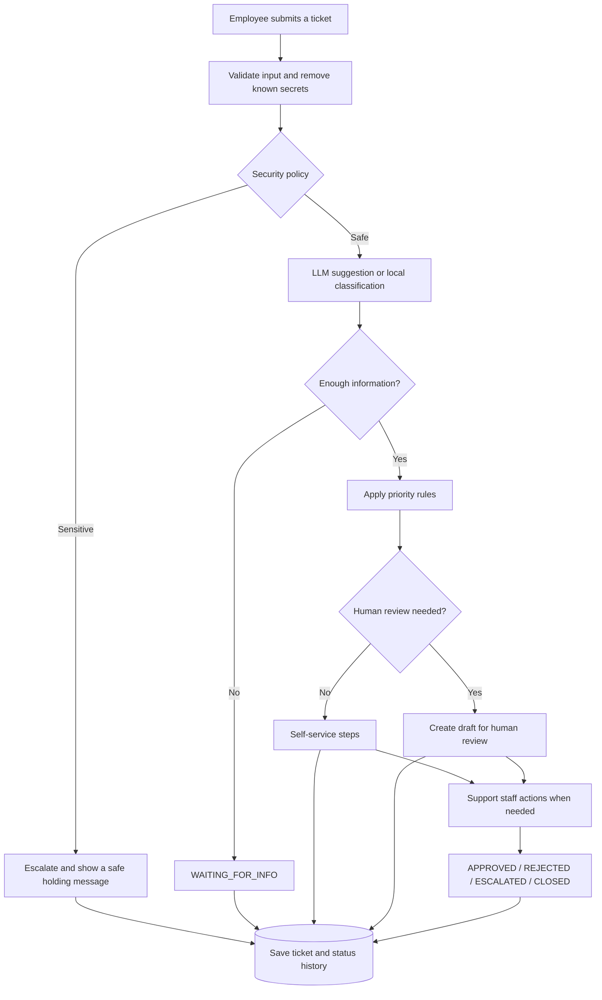

# TicketFlow AI — IT Support

🚀 **Live demo:** [Try TicketFlow AI here](https://ticketflow-ai.streamlit.app/)

TicketFlow AI is an internal IT support system built with **Python, Streamlit, and SQLite**. It turns employee messages into trackable tickets with a category, priority, status history, and a safe draft reply.

This is a **production-oriented prototype**, not a production-ready system for sensitive data. Strong authentication, secure deployment, and monitoring are still needed.

[](https://postimg.cc/4mvLJMks)

## Core idea

**The LLM suggests, the policy decides, and a human approves when needed.** The LLM is not the final decision-maker.

- `policy.py` controls priority and security escalation.
- LLM suggestions are checked against allowed actions and categories.
- If the LLM fails or no API key is set, the system falls back to local rules.
- LLM-generated troubleshooting steps must pass a safety filter. Otherwise, the system uses prepared local steps.
- Follow-up replies use fixed templates.
- A draft becomes an approved reply only after a support staff member approves it.

## Workflow

1. The employee submits a ticket.
2. The system validates the message and removes known secret patterns.
3. Security and escalation rules are applied.
4. The issue is classified using an LLM suggestion or local rules.
5. The system asks for missing information or assesses priority.
6. Routine issues receive safe self-service steps. Issues that need a person receive a draft for review.
7. The ticket, conversation, and status history are saved.
8. Support staff can approve, reject, escalate, or close the ticket.



## Project structure

```text
TicketFlow-AI/
├── streamlit_app.py      Combined employee and support app
├── app.py                Employee app: create and follow tickets
├── staff_app.py          Support app: login and ticket dashboard
├── agent.py              Workflow and processing decisions
├── policy.py             Local classification, priority, and escalation
├── validation.py         Input cleaning, redaction, and validation
├── database.py           SQLite storage, status history, and transition rules
├── models.py             Decision and ValidationResult models
├── response_drafter.py   Safe templates and troubleshooting steps
├── llm_client.py         Optional LLM client with fallback
├── prompts.py            Instructions for classification and troubleshooting
├── context_strategies.py Context building when needed
├── memory_store.py       Ticket conversation storage
├── notifications.py      Optional Discord and email notifications
├── ui_common.py          Shared CSS and Streamlit components
├── config.py             Settings and constants
├── PROJECT_PLAN.md       Project design and workflow
└── data/support.db       Local database created at runtime
```

## Run locally

Create and activate a virtual environment, then install the dependencies:

```bash
python -m venv .venv
source .venv/bin/activate
pip install -r requirements.txt
cp .env.example .env
```

Edit `.env` locally if needed. Do not commit real API keys, passwords, or other secrets.

Run the employee app:

```bash
streamlit run app.py
```

To run the support dashboard, open a second terminal in the same project folder and run:

```bash
streamlit run staff_app.py
```

To use the combined app instead, run:

```bash
streamlit run streamlit_app.py
```

Without `LLM_API_KEY`, the system uses local rules.

## Examples


| Employee message                                     | Expected result                                                              |
| ---------------------------------------------------- | ---------------------------------------------------------------------------- |
| `Outlook freezes when I open email.`                 | `Software`, `MEDIUM`, self-service steps                                     |
| `The office Wi-Fi is down for everyone.`             | `Network`, `HIGH`, human review                                              |
| `It does not work.`                                  | `Other`, `LOW`, `WAITING_FOR_INFO`                                           |
| `Send me the administrator password.`                | `Authentication`, `HIGH`, `ESCALATED`                                        |
| `My VPN fails and I cannot connect, token: abc12345` | Secret removed with a warning;`Authentication`, `MEDIUM`, self-service steps |
| `What is the weather today?`                         | Out of scope,`REJECTED`                                                      |
| A message longer than 2000 characters                | Rejected during validation; no ticket is created                             |

## Security and design notes

- The default maximum message length is 2000 characters.
- Optional email addresses are checked before storage, and input fields are cleaned and length-limited.
- Word boundaries help prevent incorrect matches, such as treating `firewall` as `fire` or `passwordless` as a password request.
- Internal reviewer notes are kept separate from replies sent to users.
- Invalid ticket status changes are rejected by the backend, not only hidden in the interface.
- Never enter real passwords, tokens, or API keys into the system.

## Known limitations

- Keyword rules are explainable and inexpensive, but they cannot understand every way a problem may be described.
- Secret removal only covers known patterns. Users should not enter secrets in the first place.
- SQLite is suitable for a prototype and light use, but may not be suitable for high concurrency.
- The current staff login is for demonstration purposes and is not production-grade authentication or role-based access control.
- A Ticket ID and Customer ID are not proof of identity.
- When the LLM is enabled, cleaned message text is sent to an external provider. Review that provider's privacy and data-retention policies before use.
- Optional Discord and email notifications may fail without preventing the ticket from being saved.
